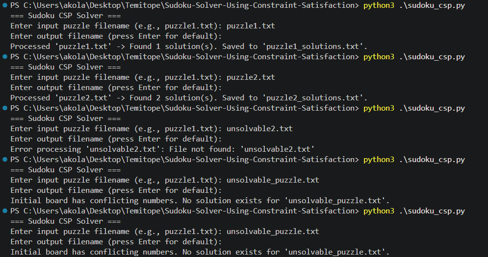

# Sudoku CSP Solver
**Course:** CSCD 501 - Advanced Algorithms  
**Name:** Temitope James DADA

## 1. Programming Language & Requirements
- **Language:** Python
- **Version:** Python 3.8+ (the assignment was done on Python 3.12)
- **Dependencies:** Standard library only (`sys`, `os`, `typing`). No external libraries required.

## 2. Compilation and Execution
The script is interpreted directly by Python without requiring compilation.

## How to Run in Visual Studio Code
- Open your terminal with Ctrl + ` (or `Cmd + `` on macOS), or select Terminal > New Terminal from the top menu bar.
- Verify Python installation
  `python --version`
- CD to where you save the code
- Run the script with no arguments:
  `python sudoku_csp.py`
- When prompted:
Enter input file: puzzle1.txt
Enter output file (press Enter for default puzzle1_solutions.txt):
- Inspect the Generated Output:
Click on any generated *_solutions.txt file in the VS Code file explorer to inspect the sequential solutions and the final Total solutions: N counter.

## CSP Model & Search Algorithm
Variables: The 81 individual cells on the 9x9 board were represented as row, col.

The puzzle was modeled as a Constraint Satisfaction Problem (CSP) where each cell is a variable, the domain of each empty cell is {1–9}, and the constraints require that no digit be repeated in any row, column, or 3×3 subgrid. The solver uses recursive backtracking search combined with forward checking and the Minimum Remaining Values (MRV) heuristic to efficiently explore assignments and find all valid solutions.

## Terminal Execution
